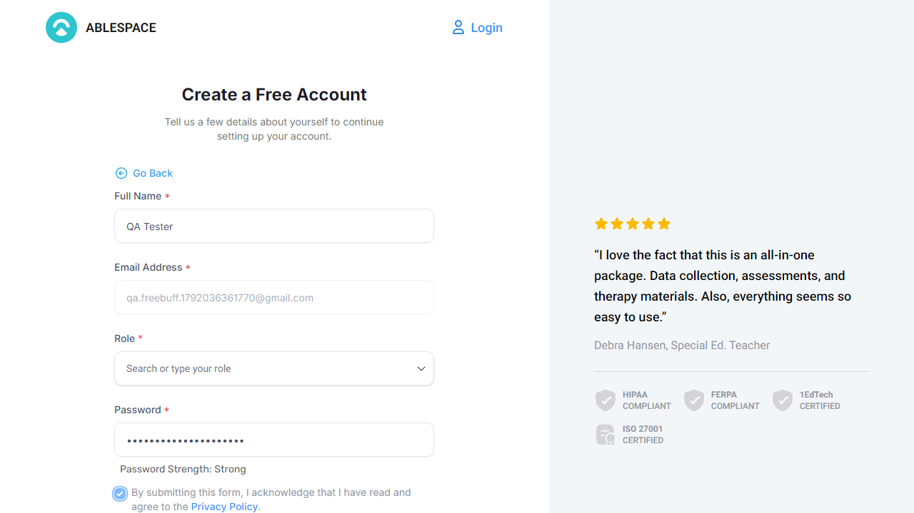
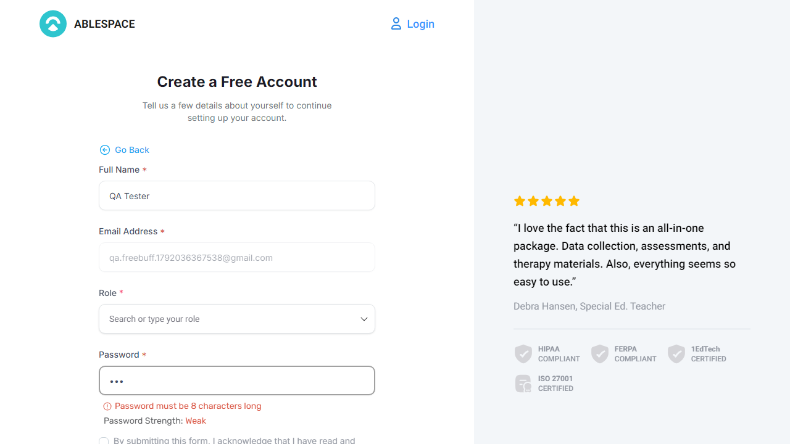

# Bonus — Playwright automation (what ran, and what did not)

The optional Playwright suite lives in [`playwright/`](playwright/README.md). This page records the **actual** run, not the intended one.

## Setup that was executed

```
Node v18.20.8 · npm 10.8.2 · @playwright/test 1.48.2 · Chromium 1140 (installed)
target: https://staging.ablespace.io
```

## Run 1 — public specs (`--project=signed-out`) · **PASSED**

```
Running 2 tests using 1 worker

  ok 1  Signup form (signed out) › SC-01a — Continue stays disabled until the required
         fields, a role and the policy are provided                (6.4s)
  ok 2  Signup form (signed out) › SC-01b — a weak password is reported as weak
         before submission                                         (5.5s)

  2 passed (13.9s)
```

These assertions are real and were green on this build:

- the e-mail step of `/signup` advances to the details step only after a syntactically valid address;
- **Continue** stays disabled with an empty form, stays disabled after only the name is filled, and the strong-password meter alone does not unlock it — the policy acknowledgement is genuinely required;
- a 3-character password is reported as weak (no "Strong" state is reached).

Screenshots written by the run itself:

| Form ready — valid details, policy ticked, **Continue** enabled | Weak password genuinely reported as weak |
|---|---|
|  |  |

## Run 2 — authenticated suite · **BLOCKED (not a pass)**

```
[setup] › auth.setup.ts › sign in and save storage state        ✘ failed (40s)
6 did not run    (caseload.spec.ts, session.spec.ts, students.spec.ts)
```

Cause, captured from the network layer rather than guessed:

```
POST https://identitytoolkit.googleapis.com/v1/accounts:signInWithPassword?key=…
400   { "error": { "message": "CAPTCHA_CHECK_FAILED",
                   "errors": [ { "message": "CAPTCHA_CHECK_FAILED", "reason": "invalid" } ] } }
```

The identical credentials sign in successfully from a normal browser window on the same machine, so this is the app's reCAPTCHA-gated Firebase Auth rejecting the automated client — the same root cause as **BUG-03** (`auth/invalid-recaptcha-token` on signup). I did not try to evade the CAPTCHA check; that is out of scope for a QA pass and would make the test suite untrustworthy anyway.

**So: the authenticated specs (BUG-01, BUG-02, BUG-05, plus the caseload regression checks) are written, reviewed and ready, but were NOT executed in my environment.** They are not counted as passes. They run as soon as a session is supplied — `ABLESPACE_STORAGE_STATE=/path/to/state.json npx playwright test`, see the suite README.

## Why the suite is still worth shipping

- The defect specs encode the correct behaviour with `test.fail()`: green while the bug is open, **red the moment it is fixed** (unexpected pass) so the marker cannot be forgotten.
- `bug evidence is automatic`: the defect specs write screenshots to `evidence/` as they reproduce each issue, so the next run produces the visual proof that this manual pass captured by hand.
- Run 1 proves the public-path assertions are accurate on the live build, so the blocked run is a session problem, not a broken suite.

## Engineering ask that came out of this

Two things a CI plan for this product needs, both discovered here:

1. A **test-account path that does not require solving reCAPTCHA** — a Firebase Auth emulator, a staging allow-list, or a session injected by the pipeline.
2. Consistency in auth error handling: signup surfaces the raw SDK error (BUG-03) while the automated sign-in failure showed **no user-visible message at all**. The wrong-password case was not verified, so this remains an observation to check rather than a raised defect.
